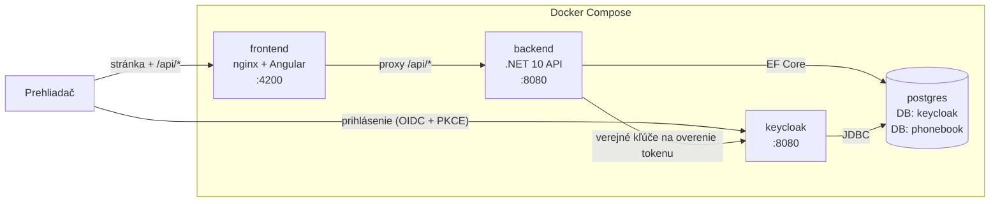

# Telefónny zoznam – .NET 10 · Angular · Keycloak · PostgreSQL

Jednoduchá full-stack aplikácia na správu telefónnych čísel.

- Po prihlásení (Keycloak) používateľ vidí zoznam telefónnych čísel.
- Čísla je možné **len pridávať a prezerať** – úprava ani mazanie nie sú možné.
- Pri pridaní používateľ volí viditeľnosť:
  - **Osobný zoznam** – číslo vidí len používateľ, ktorý ho vytvoril,
  - **Spoločný zoznam** – číslo vidia všetci prihlásení používatelia.

## Obsah

- [Rýchly štart](#rýchly-štart)
- [Docker image](#docker-image)
- [Architektúra](#architektúra)
- [Backend API](#backend-api)
- [Konfigurácia](#konfigurácia)
- [Lokálny vývoj](#lokálny-vývoj)
- [Štruktúra repozitára](#štruktúra-repozitára)
- [Rozhodnutia a obmedzenia](#rozhodnutia-a-obmedzenia)
- [Riešenie problémov](#riešenie-problémov)

## Rýchly štart

Potrebný je len **Docker** (Docker Desktop alebo Docker Engine s Compose v2).

```bash
git clone <url-repozitára>
cd <repozitár>
docker compose up
```

Prvé spustenie trvá približne minútu (stiahnutie image, štart Keycloaku). Potom otvorte:

| Čo                    | Adresa                                   | Prihlásenie       |
|-----------------------|------------------------------------------|-------------------|
| **Aplikácia**         | http://localhost:4200                    | pozri nižšie      |
| Keycloak admin konzola| http://localhost:8080/admin              | `admin` / `admin` |
| Backend API (priamo)  | http://localhost:5225/health             | –                 |

**Testovací používatelia** (realm `phonebook`):

| Používateľ | Heslo   |
|------------|---------|
| `alice`    | `alice` |
| `bob`      | `bob`   |

Odporúčaný test: prihláste sa ako `alice`, pridajte jedno osobné a jedno spoločné číslo, odhláste sa
a prihláste ako `bob` – uvidí iba spoločné číslo.

Zastavenie:

```bash
docker compose down        # zastaví kontajnery, dáta zostanú
docker compose down -v     # zastaví a vymaže aj databázu (čistý štart)
```

## Docker image

Aplikačné image sú verejne publikované na Docker Hube (platformy `linux/amd64` a `linux/arm64`):

| Služba   | Image                                                                                              |
|----------|----------------------------------------------------------------------------------------------------|
| Backend  | [`flipper130/phonebook-api:1.0.0`](https://hub.docker.com/r/flipper130/phonebook-api)              |
| Frontend | [`flipper130/phonebook-frontend:1.0.0`](https://hub.docker.com/r/flipper130/phonebook-frontend)    |

`docker compose up` ich stiahne automaticky. Ak ich chcete namiesto toho zostaviť zo zdrojového kódu:

```bash
docker compose up --build
```

PostgreSQL (`postgres:18-alpine`) a Keycloak (`quay.io/keycloak/keycloak:26.4`) sú oficiálne image.

## Architektúra



| Služba     | Technológia                 | Úloha                                                         |
|------------|-----------------------------|---------------------------------------------------------------|
| `postgres` | PostgreSQL 18               | Jeden server, dve oddelené databázy: `keycloak` a `phonebook` |
| `keycloak` | Keycloak 26                 | Prihlasovacia stránka, používatelia, vydávanie tokenov        |
| `backend`  | .NET 10, EF Core, Npgsql    | REST API, overenie tokenu, pravidlá viditeľnosti              |
| `frontend` | Angular 22, nginx           | Používateľské rozhranie, proxy `/api` na backend              |

### Priebeh prihlásenia

1. Používateľ otvorí `localhost:4200`. Angular zistí, že nie je prihlásený, a presmeruje ho na Keycloak.
2. Po zadaní mena a hesla Keycloak presmeruje späť s jednorazovým kódom, ktorý Angular vymení
   za **access token (JWT)**. Výmenu chráni **PKCE**, keďže aplikácia v prehliadači nemôže
   bezpečne uchovať tajný kľúč (client secret).
3. Angular posiela token pri každom volaní `/api/*` v hlavičke `Authorization: Bearer …`
   a pred expiráciou ho automaticky obnovuje.
4. Backend overí podpis tokenu verejným kľúčom Keycloaku a skontroluje vydavateľa (`iss`)
   aj adresáta (`aud = phonebook-api`). Ako identifikátor používateľa použije claim `sub`.

### Pravidlá viditeľnosti

Pravidlo je vynútené **na backende priamo v SQL dotaze**:

```
WHERE visibility = 'Shared' OR owner_id = <sub z tokenu>
```

Cudzie osobné čísla teda nikdy neopustia databázu. Autora záznamu určuje server z tokenu –
klient ho nemôže podvrhnúť.

## Backend API

Všetky endpointy pod `/api` vyžadujú platný access token.

| Metóda | Cesta              | Popis                                                                 |
|--------|--------------------|-----------------------------------------------------------------------|
| `GET`  | `/api/phones`      | Zoznam čísel viditeľných pre prihláseného používateľa (najnovšie prvé) |
| `GET`  | `/api/phones/{id}` | Detail jedného čísla (cudzie osobné číslo vráti `404`)                 |
| `POST` | `/api/phones`      | Pridanie čísla                                                        |
| `GET`  | `/health`          | Health check (bez prihlásenia)                                        |

Úprava ani mazanie neexistujú – `PUT`/`DELETE` vrátia `405 Method Not Allowed`.

Príklad požiadavky `POST /api/phones`:

```json
{
  "name": "Recepcia",
  "number": "+421 2 1234 5678",
  "visibility": "Shared"
}
```

Odpoveď `201 Created`:

```json
{
  "id": "01a1170b-dea4-72e7-9624-cbc942f88ec5",
  "name": "Recepcia",
  "number": "+421 2 1234 5678",
  "visibility": "Shared",
  "createdBy": "alice",
  "createdAt": "2026-10-07T15:46:56.292+00:00",
  "isMine": true
}
```

Validácia: `name` 1–100 znakov, `number` voliteľné `+` na začiatku, potom číslice, medzery,
pomlčky a zátvorky (5–32 znakov), `visibility` je `Personal` alebo `Shared`.
Neplatná požiadavka vráti `400` s popisom chýb pre každé pole.

Pripravené požiadavky na ručné testovanie sú v
[`backend/Phonebook.Api/Phonebook.Api.http`](backend/Phonebook.Api/Phonebook.Api.http).

## Konfigurácia

`docker compose up` funguje bez akéhokoľvek nastavovania. Heslá majú predvolené hodnoty
vhodné pre lokálne spustenie a dajú sa prepísať premennými prostredia alebo súborom `.env`
v koreni repozitára:

| Premenná                  | Predvolená hodnota | Význam                                  |
|---------------------------|--------------------|-----------------------------------------|
| `POSTGRES_ADMIN_USER`     | `postgres`         | Správca PostgreSQL                      |
| `POSTGRES_ADMIN_PASSWORD` | `postgres`         | Heslo správcu PostgreSQL                |
| `KEYCLOAK_DB_PASSWORD`    | `keycloak`         | Heslo k databáze `keycloak`             |
| `APP_DB_PASSWORD`         | `phonebook`        | Heslo k databáze `phonebook`            |
| `KEYCLOAK_ADMIN_USER`     | `admin`            | Administrátor Keycloaku                 |
| `KEYCLOAK_ADMIN_PASSWORD` | `admin`            | Heslo administrátora Keycloaku          |

Používané porty: `4200` (frontend), `8080` (Keycloak), `5225` (backend).

Databázy sa vytvoria pri prvom štarte PostgreSQL skriptom
[`db/init/01-create-databases.sh`](db/init/01-create-databases.sh), tabuľky aplikácie
vytvorí backend pri štarte (EF Core migrácie). Realm, klient a testovací používatelia sa
importujú z [`keycloak/realm-phonebook.json`](keycloak/realm-phonebook.json).

## Lokálny vývoj

Na vývoj mimo Dockeru je potrebné **.NET 10 SDK** a **Node.js 24.15+**.
PostgreSQL a Keycloak bežia stále v Dockeri:

```bash
docker compose up -d postgres keycloak
```

**Backend** (http://localhost:5225):

```bash
cd backend
dotnet tool restore                      # nástroj dotnet-ef
dotnet run --project Phonebook.Api
```

Pri lokálnom behu sa backend pripája na PostgreSQL cez `localhost:5432`. Port je v
`docker-compose.yml` zámerne nezverejnený, preto pre lokálny vývoj pridajte do služby
`postgres` dočasne `ports: ["5432:5432"]`.

Nová databázová migrácia po zmene modelu:

```bash
dotnet ef migrations add <NazovZmeny> --project Phonebook.Api --output-dir Data/Migrations
```

**Frontend** (http://localhost:4200, `/api` sa presmeruje na `localhost:5225`):

```bash
cd frontend
npm install
npm start
npm test        # unit testy (Vitest)
```

## Štruktúra repozitára

```
.
├── docker-compose.yml          # celé prostredie jedným príkazom
├── db/init/                    # vytvorenie databáz pri prvom štarte PostgreSQL
├── keycloak/                   # import realmu (klient, používatelia)
├── backend/
│   ├── Dockerfile
│   └── Phonebook.Api/
│       ├── Program.cs          # konfigurácia: DB, autentifikácia, endpointy
│       ├── Data/               # entita, DbContext, migrácie
│       └── Endpoints/          # REST API
└── frontend/
    ├── Dockerfile
    ├── nginx.conf              # statické súbory + proxy /api
    └── src/app/
        ├── app.config.ts       # Keycloak + HTTP interceptor
        └── phones/             # služba, formulár, zoznam
```

## Rozhodnutia a obmedzenia

- **Jeden PostgreSQL server, dve databázy.** Zadanie požaduje PostgreSQL pre Keycloak aj aplikáciu.
  Každá služba má vlastnú databázu a vlastného používateľa, takže nevidia dáta tej druhej.
- **Konfigurácia Keycloaku ako kód.** Realm sa importuje zo súboru, nie je potrebné nič klikať.
  Import prebehne len ak realm ešte neexistuje – zmeny v súbore sa prejavia po `docker compose down -v`.
- **Keycloak beží v režime `start-dev`.** Produkčný režim vyžaduje HTTPS a certifikáty, čo by
  zbytočne skomplikovalo lokálne spustenie. Pre produkciu: `start`, HTTPS, reverse proxy, silné heslá.
- **Verejná a interná adresa Keycloaku.** Prehliadač vidí Keycloak na `localhost:8080`, backend
  v Dockeri na `keycloak:8080`. Backend preto sťahuje kľúče z internej adresy
  (`Keycloak__MetadataAddress`), ale kontroluje vydavateľa voči verejnej (`Keycloak__Issuer`).
- **Adresa Keycloaku vo frontende je pevne `http://localhost:8080`.** Pri nasadení na inú doménu
  je potrebné ju zmeniť v `frontend/src/app/app.config.ts` (prípadne doplniť runtime konfiguráciu).
- **Žiadne CORS.** nginx servíruje frontend aj presmerováva `/api`, prehliadač komunikuje s jedným
  originom.
- **Identita podľa `sub`.** Vlastník záznamu sa ukladá podľa nemenného ID z Keycloaku; meno
  (`preferred_username`) sa ukladá len na zobrazenie.
- **Validácia na oboch stranách.** Frontend pre rýchlu odozvu, backend ako záväzné pravidlo.

## Riešenie problémov

| Problém | Riešenie |
|---------|----------|
| Port `4200`, `8080` alebo `5225` je obsadený | Zastavte aplikáciu na danom porte alebo zmeňte mapovanie portov v `docker-compose.yml` (pri zmene portu frontendu/Keycloaku treba upraviť aj realm a `app.config.ts`). |
| Po prihlásení sa zobrazí „Zoznam sa nepodarilo načítať“ | Backend ešte štartuje – počkajte pár sekúnd a kliknite na *Skúsiť znova*. Logy: `docker compose logs backend`. |
| Keycloak dlho štartuje | Pri prvom štarte je to bežné (~30 s). Stav: `docker compose ps`. |
| Zmena v `realm-phonebook.json` sa neprejavila | `docker compose down -v && docker compose up` (vymaže dáta). |
